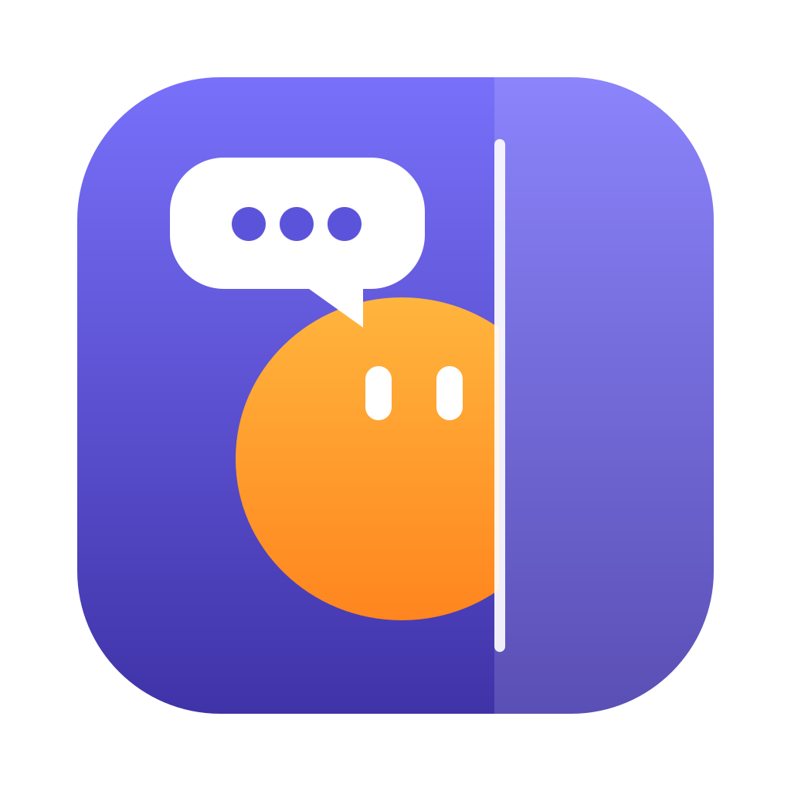
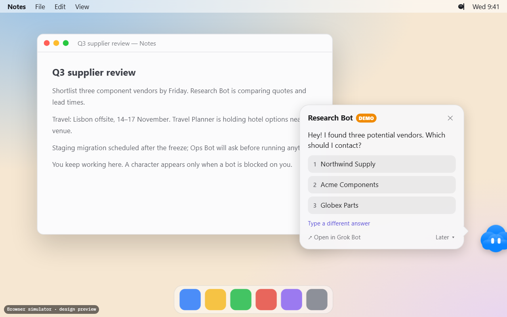
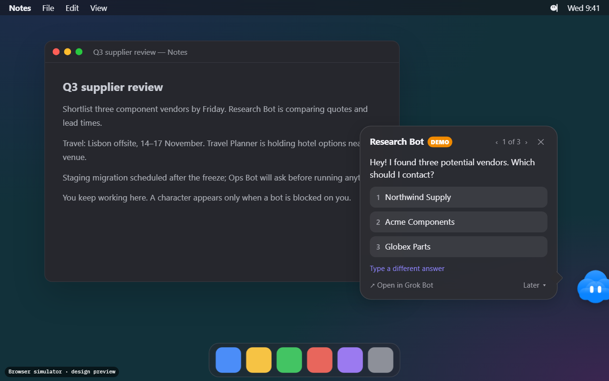
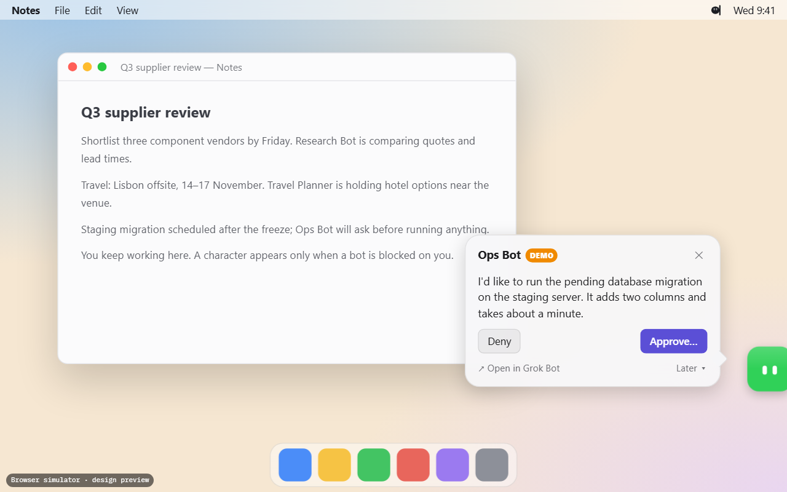
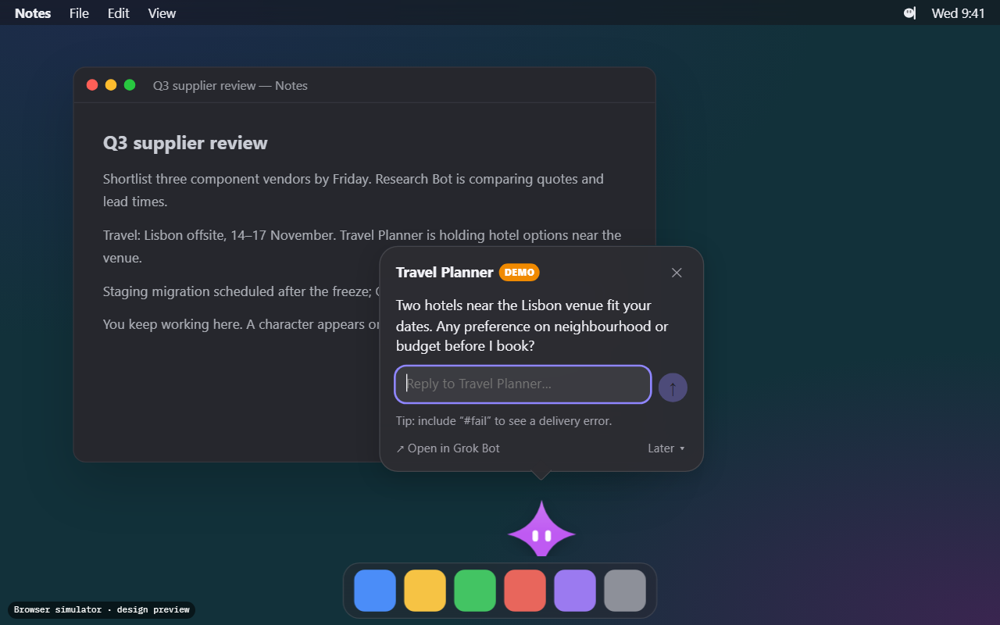

<div align="center">



# BotPeek

**Your Grok Bot bots visit you, not the other way around.**

When one of your bots needs an answer or an approval, it peeks out from the edge of
your Mac's screen, tells you what it needs, takes your reply, and hops back out of sight.

[Download](https://github.com/deni0107/botpeek/releases/latest) ·
[Try the browser simulator](https://deni0107.github.io/botpeek/) ·
[Beta testing](docs/BETA_TESTING.md) ·
[How it works](docs/INTEGRATION.md)

[](https://github.com/deni0107/botpeek/actions/workflows/ci.yml)


[](LICENSE)

</div>

> [!IMPORTANT]
> **Beta.** BotPeek has been checked on a real Mac (macOS 26, Grok Bot 0.78.1): it
> finds your bots, reads their names and avatars, draws them with Grok Bot's own
> renderer, notices questions they ask you, and answers them from the bubble (picking an
> option or typing a reply) without bringing Grok Bot forward. Other macOS and Grok Bot
> versions still need testers.
> [Please help test it](docs/BETA_TESTING.md).

> [!NOTE]
> BotPeek is an independent, free, open-source community project. It is **not
> affiliated with, endorsed by or sponsored by Grok Bot, xAI, SpaceXAI, Anysphere or Cursor.**

<p align="center">
  
  <br><sub>Design preview from the <a href="https://deni0107.github.io/botpeek/">browser simulator</a>, not a screenshot of the native app.</sub>
</p>

<p align="center">
  
  
  
</p>

## What it does

- **Appears only when needed.** A character shows up only when a bot is waiting for you:
  a question it asked in chat (with answer buttons or in plain text), an approval, a form
  to fill in. Ordinary messages, progress updates, unread counts and finished tasks never
  pop up, so "send me a test message" won't summon anyone; ask a bot to ask you something
  instead. A plain-text question shows once the bot has been quiet for a few seconds, and
  sign-offs like "Anything else?" don't count. Otherwise your screen stays clear.
- **Your real bots.** Names and avatars come from Grok Bot's own local data: uploaded
  photos (transparency kept) and built-in shapes drawn by Grok Bot's own avatar code,
  read from your installed Grok Bot. Change an avatar in Grok Bot and BotPeek follows.
- **Answer in place.** Pick an option, type a reply, or open the request in Grok Bot.
  BotPeek shows *Sending…* and says *Delivered* only after it sees the reply land in the
  right conversation. Sign-in forms and approvals open in Grok Bot; BotPeek then steps
  aside until Grok Bot marks them done, and reminds you once if they're still waiting
  after your snooze time.
- **Careful with approvals.** By default approvals open in Grok Bot. Opt in to approve or
  deny inline with a second, explicit confirmation of exactly which button will be pressed.
- **Several bots at once.** The newest request always comes first. Other waiting bots
  peek out beside it, tucked against the edge; hover to see who and how long they've
  waited, click to switch. A new bot never replaces a reply you're writing: it waits
  in the stack until you're done. Snooze and dismiss per request, a "1 of 3" switcher
  and a list in the menu bar. Nothing is lost when you dismiss.
- **Keyboard friendly.** ⌃⌥B opens the current request from any app; 1–9 pick an
  answer, ⌘[ / ⌘] switch, ⌘L snoozes, ⌘D dismisses, ⌘O opens Grok Bot.
- **Stays out of the way.** Never takes focus from your app, transparent areas are
  click-through, the bubble tucks away after 30 seconds without interaction (an
  occasional wiggle reminds you), drag the character along the edge to move it, it
  follows the pointer to another display, works across Spaces and full-screen apps,
  pauses from the menu bar, hides from screenshots and screen sharing where macOS
  allows, respects Reduce Motion, and has a minimal-animation mode.
- **Private.** No servers, analytics, tracking or network requests. Message text is never
  saved; diagnostics never contain messages or bot names.

## Install

1. Download `BotPeek-x.y.z-macos-universal.dmg` from the
   [latest release](https://github.com/deni0107/botpeek/releases/latest). It runs on Apple
   silicon and Intel Macs with macOS 14 Sonoma or newer.
2. Open it and drag **BotPeek** into **Applications**.
3. Open BotPeek. Until releases are notarized, macOS will say it can't verify the developer:
   click **Done**, open **System Settings → Privacy & Security**, and click **Open Anyway**
   next to BotPeek ([Apple's guide](https://support.apple.com/102445)). You only do this once.
   Please don't disable Gatekeeper.
4. Follow the short welcome. To read questions and reply from BotPeek, allow
   **Accessibility** when asked (System Settings → Privacy & Security → Accessibility).

Each release lists SHA-256 checksums. To verify: `shasum -a 256 BotPeek-*.dmg`.

**No Grok Bot?** Turn on **Demo Mode** from the menu bar to see sample bots (clearly marked
*DEMO*) without any account.

## Requirements and permissions

| | |
| --- | --- |
| macOS | 14 Sonoma or newer, Apple silicon or Intel |
| Grok Bot | The desktop app, signed in. BotPeek reads its local data; replies need it running. |
| Accessibility | Optional. Needed to read the full question and to deliver replies. Without it, characters still appear and *Open in Grok Bot* works. |
| Network | None. BotPeek never connects to the internet. |

Replying uses the same Accessibility interface as VoiceOver: BotPeek presses Grok Bot's
answer buttons or types your reply into its message box and presses Send, all without
bringing Grok Bot forward (it does switch Grok Bot's open conversation to that bot in the
background). Details and safety rules:
[docs/INTEGRATION.md](docs/INTEGRATION.md).

## What works today

| Area | State |
| --- | --- |
| Roster parsing, attention detection, dedupe, queue, snooze/dismiss, reply routing & validation, animation plans, placement | Implemented, **100+ automated tests** on macOS CI (Apple silicon and Intel) |
| Native app: floating characters, bubble, menu bar, settings, onboarding | Implemented, builds in CI; runs on macOS 26, **more beta testing wanted** |
| Live Grok Bot: discovery, names, built-in avatars | **Verified** on a real Mac with Grok Bot 0.78.1 |
| Live Grok Bot: detecting questions asked in chat (answer buttons) | **Verified** on a real Mac with Grok Bot 0.78.1 |
| Live Grok Bot: detecting questions asked in plain text | Implemented; message format checked with Grok Bot 0.78.1 |
| Live Grok Bot: answering multiple-choice and multi-select questions from the bubble, in the background | **Verified** on a real Mac with Grok Bot 0.78.1 |
| Live Grok Bot: typed replies in the background | **Verified** on a real Mac with Grok Bot 0.78.1 |
| Live Grok Bot: sign-in forms and approvals open in Grok Bot | **Verified** on a real Mac with Grok Bot 0.78.1 |
| Inline approvals (Approve/Deny answer buttons) | Off by default; **verified** on a real Mac with Grok Bot 0.78.1. Grok Bot's own approval requests always open in Grok Bot |
| Signed/notarized releases | Supported by the release workflow once credentials are added; current builds are ad-hoc signed |

Known limitations: built-in avatars fall back to BotPeek's own drawings when Grok Bot
isn't installed or an update changes its avatar code; conversation reading assumes Grok Bot's English UI; replying switches Grok Bot's
open conversation in the background; ad-hoc-signed updates need Accessibility re-granted.

## Browser simulator

[`simulator/`](simulator/index.html) is an interactive, browser-based mock-up of the
design: entrance and exit animations, bubbles, choices, text replies, approvals, the queue,
edges, sizes, animation levels and dark mode. It is published at
**https://deni0107.github.io/botpeek/** and clearly labelled as a simulator. It shares no
code with the app and cannot talk to Grok Bot.

## Build from source

You only need this to develop BotPeek. Requires macOS 14+ with Xcode 16 (or the matching
command-line tools).

```bash
git clone https://github.com/deni0107/botpeek.git
cd botpeek
swift test                      # all tests
swift run BotPeek               # run from the terminal (menu bar app)
./scripts/build-app.sh          # dist/BotPeek.app, universal, ad-hoc signed
./scripts/package.sh            # DMG + ZIP + SHA256SUMS.txt
```

Every push builds and tests the full app on GitHub's macOS runners. Command-line checks for testers:

```bash
/Applications/BotPeek.app/Contents/MacOS/BotPeek --version
/Applications/BotPeek.app/Contents/MacOS/BotPeek --check
```

## Releases

Push a tag that matches `VERSION` (for example `v0.1.0`). The
[release workflow](.github/workflows/release.yml) tests, builds a universal app, packages
a DMG and ZIP with checksums, smoke-tests it on an Intel runner and publishes a GitHub Release.
Add the secrets listed at the top of that workflow to sign with a Developer ID and notarize;
without them the release is ad-hoc signed and its notes explain how to open it.

## Contributing

Bug reports, beta-test reports and pull requests are welcome. Start with
[CONTRIBUTING.md](CONTRIBUTING.md), and see [docs/ARCHITECTURE.md](docs/ARCHITECTURE.md).
Please follow the [Code of Conduct](CODE_OF_CONDUCT.md), and report security issues
privately ([SECURITY.md](SECURITY.md)).

## Credits and license

MIT © BotPeek contributors. The Accessibility approach adapts
[grok-bot-mcp](https://github.com/rthomas24/grok-bot-mcp) (MIT, © Ryan Thomas); see
[THIRD_PARTY_NOTICES.md](THIRD_PARTY_NOTICES.md). Grok, Grok Bot, xAI and Cursor are
trademarks of their respective owners. BotPeek bundles no third-party artwork.
