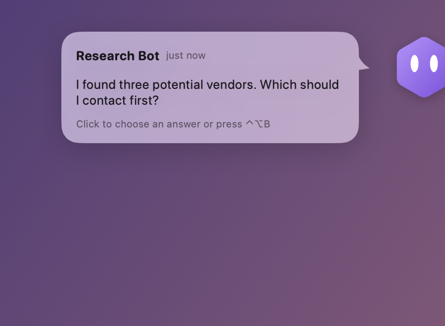
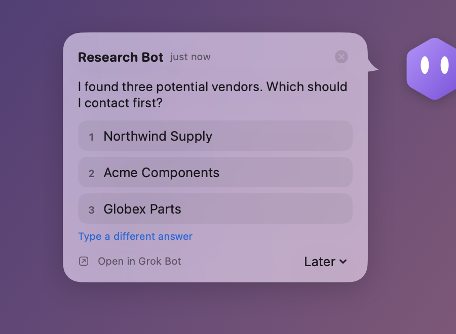
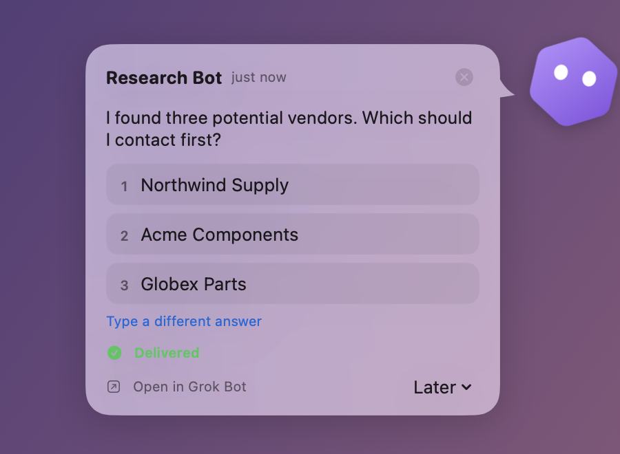

<div align="center">


# BotPeek

**Your Grok Bot bots visit you, not the other way around.**

When a bot needs an answer or an approval, it peeks out from the edge of your Mac's
screen, takes your reply, and hops back out of sight.

[Download](https://github.com/deni0107/botpeek/releases/latest) ·
[How it works](docs/INTEGRATION.md)

[](https://github.com/deni0107/botpeek/actions/workflows/ci.yml)
[](LICENSE)





<br><sub>A real Grok Bot question in BotPeek on macOS 26: it peeks, you answer, it's delivered.</sub>

</div>

> [!NOTE]
> Beta, provided as is. Tested with macOS 26 and Grok Bot 0.78.1. BotPeek is an
> independent project, not affiliated with Grok Bot, xAI or Cursor.

## Features

- **Appears only when needed:** questions (with buttons or in plain text), approvals and
  forms. Never for ordinary messages, progress or unread counts.
- **Your real bots,** with their names and avatars from Grok Bot's local data.
- **Answer in place:** pick an option or type a reply without switching to Grok Bot.
  *Delivered* is shown only once the reply is confirmed. Approvals and sign-in forms open
  in Grok Bot unless you opt in to inline approvals.
- **Several bots at once,** newest first, with snooze, dismiss and a menu-bar list.
- **Out of the way:** never steals focus, click-through, works across Spaces and full
  screen, respects Reduce Motion. ⌃⌥B opens the current request from any app.
- **Private:** no network access, no analytics, message text is never saved.

## Install

1. Download the DMG from the [latest release](https://github.com/deni0107/botpeek/releases/latest)
   and drag BotPeek into Applications. Requires macOS 14 or newer.
2. If macOS says it can't verify the developer, go to **System Settings → Privacy &
   Security** and click **Open Anyway**.
3. Allow **Accessibility** when asked. It's needed to read questions and send replies;
   without it, characters still appear and open Grok Bot.

No Grok Bot? Turn on **Demo Mode** from the menu bar.

**Known limitations:** assumes Grok Bot's English UI; replying switches Grok Bot's open
conversation in the background; unsigned updates need Accessibility granted again.

## Build from source

Requires macOS 14+ and Xcode 16.

```bash
swift test                # run the tests
swift run BotPeek         # run the app
./scripts/build-app.sh    # build dist/BotPeek.app
./scripts/package.sh      # build the DMG and ZIP
```

## Contributing

Issues and pull requests are welcome; see [CONTRIBUTING.md](CONTRIBUTING.md). This is a
spare-time project, so there's no promise of support or fixes.

## License

[MIT](LICENSE). Includes code adapted from grok-bot-mcp; see
[THIRD_PARTY_NOTICES.md](THIRD_PARTY_NOTICES.md).
